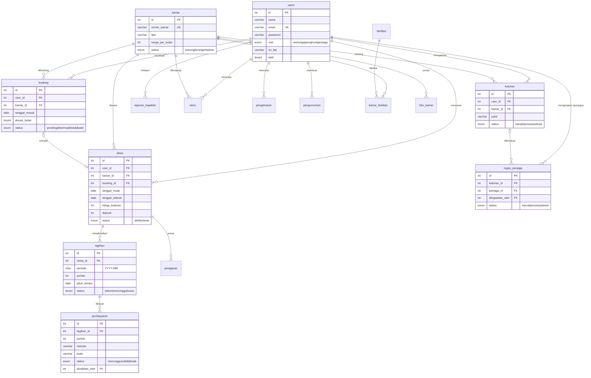

# ERD – Database Kosan

Buka file ini di VS Code dengan ekstensi *Markdown Preview Mermaid Support*, atau tempel blok di bawah ke https://mermaid.live untuk melihat diagramnya.

## Daftar tabel (16)
| Tabel | Fungsi |
|---|---|
| users | Akun semua role |
| kamar | Data kamar |
| fasilitas | Master fasilitas (AC, WiFi, ...) |
| kamar_fasilitas | Relasi kamar ↔ fasilitas (many-to-many) |
| foto_kamar | Foto tiap kamar |
| booking | Pemesanan kamar oleh calon penghuni |
| sewa | Kontrak sewa aktif / selesai |
| pengajuan | Permintaan perpanjang / berhenti dari penghuni |
| tagihan | Tagihan bulanan per sewa |
| pembayaran | Bukti bayar & validasi |
| keluhan | Keluhan / permintaan perbaikan |
| tugas_penjaga | Tugas dari GA ke penjaga |
| tamu | Buku tamu |
| laporan_kejadian | Laporan kejadian dari penjaga |
| pengeluaran | Biaya operasional |
| pengumuman | Info untuk penghuni |
